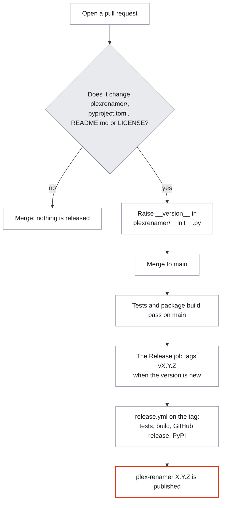

<div align="center">


# 🎬 plex-renamer

### Name your media the way Plex expects. Undo any run.

**A command-line tool that renames the movies and shows on a media drive to the folder and file
names Plex documents, so that Plex can match them.** It works out what each folder holds, plans
every move, shows you the plan, and only then renames. Every run is written to a journal first, so
any run can be undone, also one that was cut off halfway.

<br>

[](https://pypi.org/project/plex-renamer/)


<br>


<br>

**[What it does](#-what-it-does) · [Is it safe?](#-is-it-safe) · [Install](#-install) · [First run](#-your-first-run) · [Commands](#-commands-and-flags) · [Decisions](#-correcting-the-tool-with-decisions-files) · [Naming](#-naming-applied) · [Troubleshooting](#-troubleshooting) · [Limits](#-known-limitations) · [Contributing](#-contributing) · [Support](#-support-this-project)**

</div>

---

## 🧭 What it does

Plex matches a title most reliably when its folder and file names follow the pattern Plex
publishes. Downloaded files often don't: release tags, dots for spaces, loose files, subtitles
without a language. plex-renamer reads a library, works out what each folder holds (a movie, a show,
or a folder of several titles), and moves everything to the Plex names. The renames go through a
SQLite journal, which makes every run reversible.

Here is a small made-up library before a run:

```
Movies/
  Paper.Lanterns.2015.720p.WEB-DL.mp4
  The.Quiet.Harbour.2019.1080p.BluRay.x264-GRP/
    .DS_Store
    The.Quiet.Harbour.2019.1080p.BluRay.x264-GRP.mkv
    The.Quiet.Harbour.2019.1080p.BluRay.x264-GRP.srt
    YTS.MX - Official site.jpg
Series/
  Northern Lights Detective/
    Season 1/
      Northern.Lights.Detective.S01E01.Pilot.1080p.WEB.en.srt
      Northern.Lights.Detective.S01E01.Pilot.1080p.WEB.mkv
      Northern.Lights.Detective.S01E02.The.Frozen.Pier.1080p.WEB.mkv
```

And the same library after `plex-renamer apply`, with one correction that gives the show its year
and an IMDb id (see [decisions files](#-correcting-the-tool-with-decisions-files)):

```
Movies/
  Paper Lanterns (2015)/
    Paper Lanterns (2015).mp4
  The Quiet Harbour (2019)/
    The Quiet Harbour (2019).en.srt
    The Quiet Harbour (2019).mkv
Series/
  Northern Lights Detective (2021) {imdb-tt0000000}/
    Season 01/
      Northern Lights Detective (2021) - S01E01 - Pilot.en.srt
      Northern Lights Detective (2021) - S01E01 - Pilot.mkv
      Northern Lights Detective (2021) - S01E02 - The Frozen Pier.mkv
```

The loose file got a folder of its own, the release tags are gone, the subtitle got a language
code, and the old folders were removed once empty. The torrent-site ad and the `.DS_Store` file
were deleted, with a copy of each in the journal. `plex-renamer undo` put all of it back exactly as
it was.

---

## 🔒 Is it safe?

Here is what a run promises, and the limits of those promises.

| Promise or limit | What it means |
|---|---|
| **You see the plan first** | `plan` changes nothing in your library. `apply --dry-run` only makes and removes a scratch folder of its own to time the drive. Read the plan before you apply it. |
| **Nothing is ever overwritten** | A move whose destination is taken stops the run before it starts, unless you pass `--force`. Even then, each destination is checked again right before its rename, and a taken one fails that one move. |
| **Only two kinds of file are deleted** | Torrent-site ads (such as `YTS.MX - Official site.jpg`) and `.DS_Store` files. Each is a small file whose bytes go into the journal before it is deleted, and `undo` writes it back. Everything else in your library is only renamed or moved, and only empty folders are removed. |
| **Every run can be undone** | Also one that was cut off by Ctrl-C, a kill or a crash, and also after the drive was remounted. `undo` checks each file on disk before it moves it back, and never moves a file onto a path that is taken. |
| **Run it while nothing else writes to the library** | Nothing locks the library, so pause downloads, syncs and other tools while it runs. |
| **NAS folders are not all skipped yet** | Read [known limitations](#-known-limitations) before you run it on a NAS. |

The full list of guarantees, and what undo cannot do, is in
[Safety guarantees](https://github.com/agusgonzaleznic/plex-renamer/blob/main/docs/safety.md).

---

## ⚡ Install

You need Python 3.12 or newer. The tool uses only the standard library and makes no network calls.
The tests run on macOS, on Python 3.12 to 3.15, and other systems are not tested.

```bash
pipx install plex-renamer
```

This installs the `plex-renamer` command. `pip install plex-renamer` inside a virtual environment
works too.

Each [GitHub release](https://github.com/agusgonzaleznic/plex-renamer/releases) carries the wheel,
the source archive and a `SHA256SUMS` file. To check the files of the latest release before you
install them, in an empty folder:

```bash
gh release download -R agusgonzaleznic/plex-renamer --pattern '*'
shasum -a 256 -c SHA256SUMS
pipx install ./plex_renamer-*.whl
```

Each line of the check must end in `OK`. Without the `gh` command, download the three files from
the release page instead.

### Category folders

The tool changes your library only inside these folders at the top of your drive, apart from the
scratch folder of its speed test (step 4 below):

`Animated Movies`, `Animated Series`, `Anime Movies`, `Anime Series`, `Classes`, `Documentaries`,
`DocuSeries`, `Movies`, `Music Shows`, `Series`, `StandUp`, `Theatre`

Every category it is asked to work on must exist, so name the ones you have with `--categories`,
as in `--categories "Animated Movies" Movies`.

---

## 🚀 Your first run

### 1. Pick a working folder

The journal (`state/plex-renamer.db`), your corrections (`decisions/`) and the reports
(`reports/`) are kept in the folder you run the command from. Make one folder, such as
`~/plex-renamer-work`, and always run from it.

Always pass `--root`. Its default, `/Volumes/Multimedia`, is unlikely to be your drive. The options
`--root`, `--categories`, `--db`, `--decisions` and `--episode-case` go **before** the command
name; placed after it, they are rejected.

### 2. Plan

```bash
plex-renamer --root /Volumes/Media --categories Movies Series plan
```

This reads the library and changes nothing in it. On the made-up library above it printed (report
paths left out):

```
units: 3   file moves: 7
  Movies                 4 moves
  Series                 3 moves
flags: loose-file=1, no-year=1

lint: clean
after the moves, apply deletes these, and the ads the moves hide: 1 .DS_Store file, 1 torrent-site ad
  .DS_Store file  Movies/The.Quiet.Harbour.2019.1080p.BluRay.x264-GRP/.DS_Store
  torrent-site ad Movies/The.Quiet.Harbour.2019.1080p.BluRay.x264-GRP/YTS.MX - Official site.jpg
```

A "unit" is one title: a movie or a show. `plan` exits with status 1 when it finds a problem in
the plan or a lint finding, and lists them.

### 3. Read the reports

`plan` writes two files into `reports/`:

| File | What is in it |
|---|---|
| `plan.tsv` | Every move, one per line: category, unit, reason, old path, new path. Open it in a spreadsheet and read the last column. |
| `plan-units.json` | Every title with what the tool worked out: `kind` (movie or show), `title`, `year`, `ids`, `editions`, `flags`, `notes` and the number of moves. |

A flag marks something to check: `no-year` means no year was found, `loose-file` means a video sat
loose in the category folder. If a title, a year or a movie/show call is wrong, correct it with a
[decisions file](#-correcting-the-tool-with-decisions-files) and run `plan` again.

### 4. Dry run

```bash
plex-renamer --root /Volumes/Media --categories Movies Series apply --dry-run
```

This counts the operations, measures how fast the drive renames, and estimates the time
(14 operations on the made-up library: 4 mkdir, 7 rename and 3 rmdir, ending in `dry run, nothing
changed`). To measure the speed it makes a folder named `.plexrenamer-benchmark-...` at the top of the drive,
renames 60 scratch files in it and removes them and the folder again. `--rate` skips that.

### 5. Apply

```bash
plex-renamer --root /Volumes/Media --categories Movies Series apply
```

It renames with a progress bar, deletes the ads and `.DS_Store` files once every move has gone
through, checks the result, and ends with the command that reverses the run. Shortened, without the
progress bars:

```
run id        : 1
done: 14 operations succeeded, 0 failed
deleting: 1 .DS_Store file, 1 torrent-site ad
verify: 10 confirmed on disk, 0 mismatched

reverse this run with:  plex-renamer --db /Users/you/plex-renamer-work/state/plex-renamer.db undo --run 1
```

If any move failed, nothing is deleted; fix the cause and run `clean` later.

### 6. Verify

```bash
plex-renamer --root /Volumes/Media --categories Movies Series verify
```

This checks the newest run again: every moved file must be where the journal says, by name, kind
and size (`run 1: 10 confirmed on disk, 0 mismatched`). Check first that the drive is mounted:
`verify` doesn't check that yet, and with the drive away it reports the moved files as mismatched.

### 7. Undo, if you need to

```bash
plex-renamer --root /Volumes/Media --categories Movies Series undo --dry-run
plex-renamer --root /Volumes/Media --categories Movies Series undo
```

`undo` reverses the newest run that has not been undone, deleted files included. On the made-up
library it put back every file with the same name, size, bytes, permissions and modification time
(`undone: 17 reversed, 0 failed`).

The `status` command lists the last 20 runs in the journal and the state each one is in.

---

## 🧰 Commands and flags

| Command | What it does |
|---|---|
| `plan` | Build and check the plan, write `reports/`. Changes nothing. |
| `apply` | Run the plan, then delete ads and `.DS_Store` files, then verify. |
| `verify` | Check the newest run (or `--run N`) against the disk. |
| `undo` | Reverse the newest run that still stands (or `--run N`). |
| `status` | List the last 20 runs with their state. |
| `clean` | Delete only the ads and `.DS_Store` files, as a run of its own. |
| `prune` | Remove folders this tool emptied that hold no media, as a run of its own. |

Options that go before the command:

| Option | Default | Meaning |
|---|---|---|
| `--root PATH` | `/Volumes/Multimedia` | The top of your media drive. Always set it. |
| `--categories NAME ...` | all 12 | The category folders to work on. |
| `--db PATH` | `./state/plex-renamer.db` | The journal. |
| `--decisions PATH` | `./decisions` | The folder of decisions files. |
| `--episode-case upper\|lower` | `upper` | `S01E01` or `s01e01`. |

Options that go after the command:

| Command | Option | Meaning |
|---|---|---|
| `plan` | `--tag NAME` | Write `reports/NAME.tsv` and `reports/NAME-units.json` instead of `plan.*`. |
| `apply` | `--dry-run` | Show the operation count and time estimate only. |
| `apply` | `--force` | Run even with plan problems or blocking lint findings. Nothing is overwritten even then. |
| `apply` | `--rate N` | Use N operations per second for the estimate, skip the speed test. |
| `apply`, `clean`, `prune` | `--note TEXT` | Store a note with the run in the journal. |
| `undo`, `verify` | `--run N` | Act on run N. `undo` refuses while a later run still stands. |
| `undo` | `--force` | With `--run N`: undo it although a later run still stands. |
| `undo`, `clean`, `prune` | `--dry-run` | List what would be reversed or go, change nothing. |

---

## 📝 Correcting the tool with decisions files

When the tool gets a title wrong, you correct it in a JSON file in `decisions/`. Any `.json` file
there is read; files whose names start with `_` are read last, so their entries win. Each entry is
keyed by the title's current path from the top of the drive, exactly as `unit` shows it in
`reports/plan-units.json`.

`decisions/Series.json`:

```json
{
 "units": {
  "Series/Northern Lights Detective": {
   "year": 2021,
   "ids": {"imdb": "tt0000000"},
   "note": "year and id checked by hand"
  }
 }
}
```

With this file, `plan` printed `decisions applied to 1 units`, and the show's folder became
`Northern Lights Detective (2021) {imdb-tt0000000}`.

| Field | Meaning |
|---|---|
| `title` | The title to use. |
| `year` | The year to use. |
| `ids` | Database ids: `imdb`, `tmdb`, `tvdb` or `anidb`. One goes into the name, IMDb first. |
| `editions` | A list of edition names, such as `["Extended"]`. |
| `kind` | `"movie"` or `"show"`. |
| `season_map` | Renumber seasons, such as `{"2": 3}` for season 2 to season 3. |
| `skip` | `true` leaves the title out of the plan. |
| `hide` | `true` moves the title under a dot folder, which Plex does not scan. |
| `note` | Free text, shown in `plan-units.json`. |

---

## 🔤 Naming applied

The rules follow Plex's own support articles. The distilled ruleset is kept in
[`reports/plex-spec.json`](https://github.com/agusgonzaleznic/plex-renamer/blob/main/reports/plex-spec.json)
as a reference, with the source article for each section; the code does not read it.

| Case | Result |
|---|---|
| Movie | `Category/Title (Year) {imdb-tt…}/Title (Year) {imdb-tt…}.ext` |
| Movie edition | `Title (Year) {edition-Director's Cut}/Title (Year) {edition-Director's Cut}.ext` |
| Split movie | `Title (Year) - part1.ext`, `Title (Year) - part2.ext`, and so on |
| Show | `Category/Show (Year) {imdb-tt…}/Season 01/Show (Year) - S01E01 - Title.ext` |
| Multi-episode file | `Show (Year) - S02E01-E03.ext` |
| Specials (season 0) | `Specials/Show (Year) - S00E01 - Title.ext` |
| Subtitle | `<video name>.en.srt`, `.en.forced.srt`, `.en.sdh.srt` |
| Extras folders | `Behind The Scenes`, `Deleted Scenes`, `Featurettes`, `Interviews`, `Scenes`, `Shorts`, `Trailers`, `Other` |
| Artwork | `poster.jpg`, `background.jpg` |
| DVD rip | `Title (Year)/VIDEO_TS/…` kept intact |
| Junk | A dot in front of the name, so Plex skips it; `.hidden-` in front where a dot alone would give a name the system owns (`.DS_Store`, `._…`) or the name starts with `hidden-`. Ads and `.DS_Store` files are then deleted. |

### Where I deviate from Plex's examples

- **`S01E01`, not `s01e01`.** Plex's examples are lowercase and the token is matched
  case-insensitively. Uppercase matches what every mainstream tool already uses.
  `--episode-case lower` switches it.
- **A label before the language code from the third subtitle of one language on.** Plex documents
  only `name.lang.ext`, which would collide when a release ships several variants of one language.
  The first two files take the two code widths Plex documents, `.pt.srt` and `.por.srt`, so
  `.eng.srt` beside `.en.srt` is intended. A third one gets a label: what is left of its old name,
  as in `Movie (2019).Brazilian.pt.srt`, or else a number, as in `Movie (2019).2.pt.srt`.
- **A three-letter tag the tool does not know is kept as the language code.** Release tools name
  subtitle files by ISO-639-2 code, so `xyz.srt` becomes `Movie (2019).xyz.srt`, and `plan` lists
  every such code. A name with no language, or with `und`, is filed as English.
- **One id tag per title.** Plex documents `{imdb-…}`, `{tmdb-…}` and `{tvdb-…}` as alternatives,
  so exactly one is emitted, preferring IMDb.

---

## 🩺 Troubleshooting

| You see | What it means and what to do |
|---|---|
| `category directories not found under /Volumes/Media: [...]` | The tool was asked to work on category folders your drive does not have. Name the ones you have with `--categories`. |
| `error: unrecognized arguments: --categories ...` | Options such as `--root` and `--categories` go before the command name: `plex-renamer --root /Volumes/Media --categories Movies plan`. |
| `no journal at .../state/plex-renamer.db` | You are not in your working folder. `cd` into it, or name the journal with `--db`. |
| `refusing to run: 1 plan problems` and `destination already occupied: ...` | A file is already where the plan wants to put another one. Look at both, move or rename one by hand, or correct the title with a decisions file, then run `plan` again. |
| `WARNING 1 decision keys matched no unit` | A decisions entry names a path that does not exist. After `apply` a folder has its new name, so an entry keyed by the old name no longer matches. Update the key, or remove the entry. A second `plan` after a successful `apply` shows `file moves: 0`. |
| `run 1 is not the newest: run 2 came after it and still stands` | Runs are undone newest first. Undo run 2 first (plain `undo` picks it), then run 1. `undo --run 1 --force` exists, but read the [Safety guarantees](https://github.com/agusgonzaleznic/plex-renamer/blob/main/docs/safety.md) before you use it. |
| `undone: 16 reversed, 1 failed` with `still holds other entries, kept` | Something was added to a folder the run created. Undo keeps that folder rather than remove what is not its own. Move the new file out, then run `undo` again; it finishes the rows that are left. |
| `stopped: /Volumes/Media is not there` | The drive is not mounted. Undo changes nothing. Mount it and run `undo` again. |
| `run 1: 0 confirmed on disk, 10 mismatched` with `missing destination: ...` | The drive is probably not mounted: `verify` does not check that first. |

---

## 🚧 Known limitations

- **NAS folders whose names start with `@` or `#`.** Only the deletion of ads and `.DS_Store`
  files skips them. The renamer treats them like any other folder: a recycle bin such as
  `@Recycle` inside a category folder becomes a title of its own, and the files in a Synology
  `@eaDir` folder are moved out into the title's folder. Search `reports/plan.tsv` for `@` and `#`
  before you apply, and leave such a title out with `"skip": true` in a decisions file. Dot
  folders such as QNAP's `.@__thumb` are left alone.
- **Episodes already in a `Specials` folder** are taken for extras and left as they are. Episodes
  in a `Season 0` folder go to `Specials` with the right names.
- **Three or more episodes in one file** are only understood in the range form, `S02E01-E03`. A
  name like `S02E01E02E03` comes out as `S02E01-E02 - E03`.
- **`verify` does not check that the drive is mounted.** With the drive away it reports the moved
  files as mismatched. `undo` checks, and stops.
- **It never looks a title up online.** Years and ids come from the folder and file names and from
  your decisions files.

---

## 🤝 Contributing

Issues and pull requests are welcome at
[github.com/agusgonzaleznic/plex-renamer](https://github.com/agusgonzaleznic/plex-renamer). Please
read the [contributing guide](https://github.com/agusgonzaleznic/.github/blob/main/CONTRIBUTING.md)
first.

Run the tests from a clone:

```bash
python3 -m unittest discover -s tests -v
```

They cover the naming patterns, plan validation, the apply and undo round trip byte for byte, runs
cut off at every single step, a library that disappears and network-share quirks. CI runs them on
macOS, on Python 3.12 to 3.15, for every pull request and every push to main.

From a clone, `python3 -m plexrenamer` runs the code in place, with the same commands and options.
It keeps `state/`, `decisions/` and `reports/` in the folder you run it from, and git ignores them
(apart from `reports/plex-spec.json`).

### 🔁 How a release happens

The merge of a pull request is the release. Nobody pushes a tag by hand.



A pull request that changes what ships raises `__version__` in `plexrenamer/__init__.py`, and its
check `Release / Check the version` fails until it does. Tests, docs and workflows ship with the
next version. The release publishes the wheel, the source archive and their `SHA256SUMS` on GitHub,
then uploads the same files to PyPI with Trusted Publishing, so the workflow uses no PyPI token.

---

## 💛 Support this project

plex-renamer is MIT-licensed and free to use. If it saved you an evening of renaming a library by
hand, three things help:

- **Star the repo.** It tells the next person with a messy drive that this exists.
- **Open an issue** when a name comes out wrong, with the folder name and what you expected.
  Those reports are how the rules get better.
- **Drop a coffee on Ko-fi, or sponsor on GitHub.** Ko-fi is a one-off, and GitHub Sponsors can
  be monthly or one-time, with a custom amount.

<div align="center">
<br>

[](https://ko-fi.com/agusgonzaleznic)
[](https://github.com/sponsors/agusgonzaleznic)
<br>
[](https://agusgonzaleznic.com)
[](https://github.com/agusgonzaleznic)
[](https://www.linkedin.com/in/agusgonzaleznic)

<br>

<sub>Built in Berlin by <b>Agustin Gonzalez Nicolini</b>. I work on engineering leadership and write
about it at <a href="https://agusgonzaleznic.com">agusgonzaleznic.com</a>.</sub>

</div>

---

## 📄 Licence

MIT. See [LICENSE](https://github.com/agusgonzaleznic/plex-renamer/blob/main/LICENSE).
